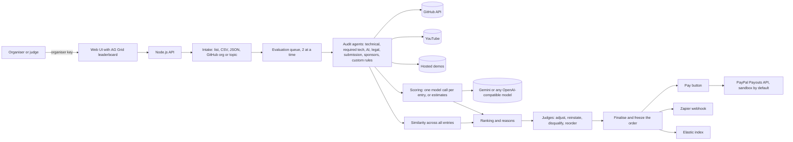

# JudgeMintAI

**An assay office for hackathon entries.** Give JudgeMintAI the entries of any hackathon or competition and it works out which ones are real, which are copies, which break the rules, and how the rest rank. It writes the reason for every rank, and the judges keep the final say. When the judgement is final, each prize can be paid through **PayPal** from the same screen.

Built for the *Build What's Next with PayPal and AI* hackathon, but it is not tied to it. The event's rules are settings: which technology entries must use, AI, licence, video, dates, and rules of your own in plain words. Payments only ever run in PayPal's **sandbox** unless you switch live payouts on yourself, so by default no real money moves.

There are two ways in:

| | What it does | Who uses it |
| --- | --- | --- |
| **Judge mode** (`/competitions`) | Takes all the entries of an event, audits and scores each, spots copies, ranks them, explains every rank, lets judges adjust, finalises, and pays the prizes through PayPal | Organisers and judges |
| **Audit one entry** (`/`) | One entry, one scorecard with a fix list, and an optional signed certificate bought through the PayPal sandbox | A team before it submits |

## What Judge mode does

1. **Bring in the entries.** Paste a list, upload a CSV, paste JSON, or point at a GitHub organisation or topic. Set how many to evaluate. The prototype defaults to 10 and this server allows up to 50 (`MAX_PROJECTS_HARD`). Entries over the limit are left out (you are told how many), and you can raise the limit later.
2. **Check each entry is real and follows the rules.** The audit agents check technical validity (public repo, real source, run steps, commit history, tests, leaked secrets, reachable demo), authentic use of the required technology (real calls in code, not a mention in the README, test or sandbox mode, keys read from the environment), real use of AI, licence, video and date rules, and your own written rules. Rules the AI cannot judge are listed for a human instead of being guessed.
3. **Look for fakes and copies.** Entries are compared with each other: the same repository entered twice, forks, identical files, similar code (renamed variables do not hide it), the same video or demo, and near-identical descriptions. The copy is named, the original is named, and the entry with the earlier history is treated as the original. A high-severity code copy keeps an entry off the ranking until a judge decides.
4. **Score each entry** from 0 to 10 on criteria you choose. The defaults: problem solving, impact on society, helpfulness, technical complexity, creativity, feasibility, viability and efficiency. Edit, remove, add, and re-weight them for your event.
5. **Rank them and say why.** Every entry gets a rank and a short explanation: the strongest and weakest criteria, how far behind the entry above it is and where, the audit result, the flags, and any judge adjustment.
6. **Judges decide.** Open any entry to read the evidence. Adjust any score by up to 5 points, reinstate or disqualify with a reason, move entries up or down by hand, and leave comments. Everything is recorded in a decision log with the judge's name.
7. **Finalise, then pay.** Finalising freezes the order and gives each prize to the entry that holds its place. Each prize then has a **Pay** button. It asks for the winner's PayPal email, shows exactly what will be sent, and sends the money through PayPal's Payouts API.
8. **Export.** One CSV with ranks, scores, reasons and flags.

## How it works



### Scoring and ranking

* **Merit** is the weighted average of the criteria, scaled 0 to 100.
* **Final score** = (1 − c) × merit + c × audit score. `c` is how much the audit counts: 20% by default, 50% at most. Set it per competition.
* **Not ranked** until a judge decides: entries whose audit failed, entries that were disqualified, entries with a high-severity code copy, and entries that could not be evaluated. They stay on the leaderboard with the reason.
* Ties are broken the same way every time (final score, then merit, then audit, then name), so a rank never changes between page loads.
* With an AI key, one model call per entry produces the 0 to 10 scores and a short reason for each. Without a key the scores are **estimates** from the audit facts and the wording, labelled as estimates with a confidence, and judges are told to review them.
* The model sees the entry's pitch, its declared tools, the first 900 characters of its README and the audit's measured facts. It never sees source code. If an entry's text tries to instruct the AI judge, the entry gets no AI scores and a visible flag.

### The audit agents

| Agent | What it checks |
| --- | --- |
| Technical Validity | Public repo, real source, README run steps, manifest, commit history, progress during the event, tests, **leaked secrets**, reachable demo |
| Required technology | For each technology the event requires: is it really called in code (not only named in the README), in test or sandbox mode, with credentials from the environment. Well-known services (PayPal, Stripe, Twilio, OpenAI, Google Maps and more) are recognised automatically; any other name is searched for in code and manifests |
| AI Usage | AI provider detected, model really called, prompts, AI in the core path, failure handling, declared tools match code |
| Legal and Compliance | Public repo, open-source licence, video public and short enough (with a YouTube API key), no false endorsement claims, **no prompt injection aimed at AI judges** |
| Submission Completeness | Description, tools explained, repo link, demo or run steps, video link, documentation |
| Sponsor Tools | Which of the event's sponsor tools are wired into the code, and which claims have no code behind them |
| Custom rules | Each rule you wrote in plain words is checked by the AI model, or listed as *needs a human check* when there is no key |

The PayPal hackathon preset turns on exactly the hackathon's rules: a real PayPal sandbox integration, AI, a public licence, a video of at most three minutes, and the ten sponsor tools. Choose *Any hackathon or competition* to set your own.

Every check has a weight and a result (pass, warning, fail, not applicable), so each score can be explained down to the line of code. Rules for the verdict: any *critical* failure means **Fail**, any *high* failure caps the verdict at **Needs review**, otherwise the score decides (80 or more passes).

### Safety by design

* **Organiser key.** Everything in Judge mode needs the organiser key: it shows entry emails and can send money. The server prints it at start and keeps it in `data/.organizer_key`; set `ORGANIZER_KEY` to choose your own. Wrong keys are rate limited.
* **Money moves only on purpose.** A prize can be paid only after the judges finalise, only to a ranked entry with a valid PayPal email, only after a confirmation that repeats the amount, currency, email and entry, and never above `MAX_PAYOUT_PER_PRIZE`. Each attempt has a fixed PayPal reference, so a double click, a retry or a restart cannot pay twice. The prize is marked *sending* before PayPal is called, so a crash can never leave a payment looking unpaid. After a payment starts, the judgement can no longer be reopened.
* **Sandbox first.** Payouts use PayPal's sandbox host. Live PayPal is refused unless you set `ALLOW_LIVE_PAYOUTS=true` and use live keys.
* **Untrusted text stays untrusted.** Repository text goes to the model as data. Secrets found in repositories are redacted in every report. Text aimed at AI judges is flagged and gets no AI scores. The server refuses to fetch private or local network addresses when probing demos (SSRF guard).
* **Spreadsheet-safe export.** Cells that start with `=`, `+`, `-` or `@` are neutralised in the CSV.
* **Certificates** (single-entry mode) are only signed after the server reads the PayPal order back itself and checks status, amount and currency.

## Tech and AI tools used

| Tool | Role |
| --- | --- |
| **PayPal Payouts API** (sandbox) | Pays the prizes from the Judge mode leaderboard. The PayPal AI Toolkit has no payout tool, so this one is called directly (`src/payouts.js`) |
| **PayPal AI Toolkit** (`@paypal/mcp`) | Runs inside the app for single-entry certificate checkout: the server starts PayPal's MCP server and calls `create_order` and `pay_order` (`src/paypalToolkit.js`). Also registered in `.vscode/mcp.json` for AI coding assistants |
| PayPal Orders v2 (sandbox) | Certificate checkout: PayPal buttons, server-side capture, and the safety net behind the toolkit |
| Model Context Protocol client | `src/mcp.js`, a small client written for this project (JSON-RPC over stdio, no dependencies) |
| Gemini 2.5 Flash, or any OpenAI-compatible model | Scores, reasons, bounded head-judge adjustment, custom-rule checks, PayPal code review |
| AG Grid Community (sponsor) | The leaderboard and the checks table: sortable, filterable, with a plain table as fallback |
| Render (sponsor) | Hosting through `render.yaml` |
| Zapier (sponsor) | Webhook for `audit.completed`, `competition.finalised` and `prize.paid`, so the organiser's tools hear about every step |
| Elastic (sponsor) | Every completed single audit is indexed, and when the judges finalise a competition every entry is indexed too (rank, scores, flags and the reason for the rank, never an email address), so organisers can search and aggregate the whole field |
| Postman (sponsor) | `postman/JudgeMintAI.postman_collection.json` runs the audit, certificate and Judge mode APIs |
| Node.js 20+ | Backend with **zero npm dependencies** (built-in `http`, `fetch`, `crypto`, `node:test`) |

## Run it locally

You need [Node.js](https://nodejs.org) 20 or newer. For prize payments and certificates you also need a free [PayPal developer account](https://developer.paypal.com).

```bash
cd judgemintai
cp .env.example .env      # on Windows: copy .env.example .env
# open .env and fill in your keys (see below)
npm start
```

Open <http://localhost:3000>. There is nothing to install because the backend has no dependencies. The terminal prints the **organiser key** and the address of Judge mode (<http://localhost:3000/competitions>).

### Use Judge mode

1. Open **Judge mode** in the menu and paste the organiser key from the terminal. Type your own name so the decision log shows who did what.
2. **New competition.** Give it a name, choose *Any hackathon or competition* (or the PayPal hackathon), and fill in the rules: the technology entries must use, the theme, whether sandbox mode, AI, a licence, a video or run steps are required, the dates, and any rules of your own, one per line.
3. Adjust the **criteria** if the defaults do not suit the event. Set how much the **audit** counts.
4. Choose how many entries to evaluate and bring them in. In *Paste a list* each line is `name | repo link | demo | video | PayPal email`, in any order, and only the repository link is required. In *GitHub* you give an organisation or a topic. Add prizes if you want them paid (for example 100 USD for first place).
5. Press **Create competition**. Evaluation runs two entries at a time and the leaderboard fills in as each finishes. A first run with three or four entries takes a minute or two.
6. Read the leaderboard. Open an entry to see the explanation, the scores, the rule checks, the copies and the evidence. Adjust, comment, disqualify or reinstate. Move entries with the arrows if the judges disagree with the computed order.
7. **Finalise the judgement.** The order is frozen and each prize is given to the entry that holds its place.
8. For each prize: enter the winner's PayPal email if it is missing, press **Pay**, and check the confirmation. *Check with PayPal* refreshes the payment status.
9. **Export CSV** for your records.

### Environment variables

| Variable | Needed | Purpose |
| --- | --- | --- |
| `ORGANIZER_KEY` | Recommended | The key for Judge mode. If empty the server makes one and prints it |
| `PAYPAL_CLIENT_ID`, `PAYPAL_CLIENT_SECRET` | For prizes and certificates | Sandbox app credentials from PayPal Developer, Apps and Credentials, Sandbox |
| `LLM_API_KEY` | Recommended | Turns on the AI scoring and head judge. A free Gemini key from Google AI Studio works with the defaults |
| `GITHUB_TOKEN` | Recommended | Without it GitHub allows 60 requests an hour, enough for about 10 entries. A free token (no scopes) allows 5000 |
| `MAX_PROJECTS_DEFAULT`, `MAX_PROJECTS_HARD` | Optional | Entries evaluated by default (10) and the most this server allows (50). Raise them on a bigger server |
| `EVAL_CONCURRENCY` | Optional | Entries evaluated at the same time, 1 to 4 (default 2) |
| `LLM_RPM`, `LLM_RETRY_MS` | Optional | Model calls per minute (Gemini's free tier: 10, the default; `0` means no limit) and the wait before retrying when the model says "too many requests" |
| `MAX_PAYOUT_PER_PRIZE` | Optional | The largest single prize this server will send (default 5000) |
| `ALLOW_LIVE_PAYOUTS` | Optional | Leave unset. `true` lets Judge mode pay real money, and only if you also use live PayPal keys |
| `PAYPAL_VIA` | Optional | Single-entry certificates: `auto` (default) toolkit first, REST as safety net; `toolkit`; `rest` |
| `PUBLIC_URL` | Optional | Where buyers return to after PayPal. Empty on your computer, Render fills it in |
| `YOUTUBE_API_KEY` | Optional | Lets the Legal agent verify a video is public and short enough |
| `ZAPIER_WEBHOOK_URL` | Optional | A Zapier "Catch Hook" URL |
| `ELASTIC_URL`, `ELASTIC_API_KEY` | Optional | Elasticsearch endpoint and API key. Single audits go to the index `judgemint-audits` and the entries of a finalised competition go to `judgemint-entries` (rename them with `ELASTIC_INDEX` and `ELASTIC_ENTRIES_INDEX`) |

Without `LLM_API_KEY` the app still works in **rule-based mode**. Every audit check runs, the scores are labelled estimates, custom rules are listed for a human to check, and only the written notes are skipped.

### Set up the PayPal sandbox (for prizes and certificates)

1. Sign in at developer.paypal.com and open **Apps and Credentials**, then switch to **Sandbox**.
2. Create an app (or use the default one) and copy the **Client ID** and **Secret** into `.env`.
3. Make sure the sandbox business account that owns the app is funded (the Sandbox Accounts page shows its balance). If PayPal answers *NOT_AUTHORIZED* when you press Pay, open the app's settings under **Features** and check that Payouts is available to it, because Payouts access can be limited per app or account. The page shows PayPal's own words.
4. Open **Testing Tools, Sandbox Accounts**. PayPal creates a business account (it pays the prizes) and a personal one (use it to pay for certificates and to receive a test prize). Use the personal account's email as a winner's PayPal email, then sign in to sandbox.paypal.com with it to see the money arrive. An email with no sandbox account shows as *Sent, not claimed yet*.
5. Restart `npm start`. The footer shows *PayPal sandbox: connected*, and the terminal says *Prize payouts: PayPal sandbox (no real money)*.

### The PayPal AI Toolkit inside the app

When someone buys a single-entry certificate, the server does not simply call PayPal's REST API. It starts PayPal's own MCP server (`npx -y @paypal/mcp`) as a child process and asks it to run two tools:

| Moment | Toolkit tool | What our server adds |
| --- | --- | --- |
| The buyer clicks the PayPal button | `create_order` | Stores the order id on the audit (the toolkit cannot tag orders) |
| The buyer approves in the PayPal popup | `pay_order` | Reads the order back from PayPal itself and checks status, amount and currency before it signs anything |

What to expect:

* The first start downloads the package from npm and can take a minute. The footer shows *PayPal AI Toolkit: starting up*, then *ready*.
* With the default `PAYPAL_VIA=auto`, any toolkit problem (no internet, npm blocked, a crash, a slow answer) sends that payment step through PayPal's REST API instead, and the log says so. Set `PAYPAL_VIA=toolkit` to turn the safety net off, for example while recording the demo video, and `PAYPAL_VIA=rest` to turn the toolkit off.
* The certificate shows which route moved the money (*Paid through*), and `GET /api/config` reports the toolkit state and call counts.
* Prize **payouts** do not use the toolkit, because it has no payout tool. They call PayPal's Payouts API directly.

### Use the PayPal AI Toolkit while coding

`.vscode/mcp.json` registers PayPal's MCP server so an AI coding assistant in VS Code can create sandbox orders and invoices for you. It asks for a sandbox access token, which this command prints:

```bash
node scripts/get-sandbox-token.mjs
```

## Test it

```bash
npm test
```

The test suite starts local stand-ins for GitHub, the PayPal sandbox (orders and payouts), YouTube, the AI model and PayPal's MCP server, so it needs no internet and no keys. It audits JudgeMintAI **with itself**, checks that fake PayPal repositories are caught, that leaked secrets never appear in a report, and walks the whole certificate flow. For Judge mode it runs a complete competition: import limits, entries that fail or are copies, the effect of renamed variables on copy detection, instructions hidden in a README, the ranking maths and tie-breaks, judge adjustments, reordering, finalising, and prize payment including double clicks, wrong confirmations, declined and unclaimed payouts, a crash between "sending" and PayPal's answer, and the organiser key on every route.

Two things only your own machine can confirm: the real `@paypal/mcp` package (it needs internet; start the app and look for *PayPal AI Toolkit ready*) and real PayPal sandbox payouts (press Pay on a test prize and open the sandbox personal account). The browser screens were walked through in a real headless Chromium against the same stand-ins; AG Grid itself loads from a CDN, so on a machine without internet the plain table shows instead and works the same.

To exercise the real API, import `postman/JudgeMintAI.postman_collection.json` into Postman (set `organizerKey` first), or run it from the terminal with `npx newman run postman/JudgeMintAI.postman_collection.json --env-var organizerKey=<your key>`.

## Deploy to Render

1. Push this repository to GitHub.
2. In Render choose **New, Blueprint** and select the repository. `render.yaml` configures a free Node web service and generates an organiser key for you (see the service's *Environment* tab).
3. Add `PAYPAL_CLIENT_ID`, `PAYPAL_CLIENT_SECRET`, `LLM_API_KEY` and `GITHUB_TOKEN` in the Render dashboard.
4. Use the Render URL as your hosted demo link. Judge mode asks for the organiser key, so the public cannot see rankings or pay anyone.

Render's free tier sleeps when idle, so the first request after a pause takes about a minute. Its disk is not kept: files written under `data/` are lost when the service restarts or redeploys, so export the CSV when you finish. Use a paid disk or a database if competition data must survive. The organiser key stays the same because it is an environment variable.

## API

Everything under `/api/competitions` and `/api/organizer/check` needs the header `X-Organizer-Key`.

| Method and path | Purpose |
| --- | --- |
| `POST /api/competitions` | Create a competition. Body: `name`, `preset` (`generic` or `paypal`), `rules`, `criteria`, `maxProjects`, `prizes`, `import`, `start` |
| `GET /api/competitions`, `GET /api/competitions/:id` | List, or one competition with the leaderboard, flags, prizes and decision log |
| `PATCH /api/competitions/:id` | Change the name, rules, criteria, audit weight, limit or prizes (until finalised) |
| `DELETE /api/competitions/:id` | Delete it (refused once a payment has started) |
| `POST /api/competitions/:id/projects` | Add entries. Body: `text`, `csv`, `json` or `github`, and `start` |
| `PATCH /api/competitions/:id/projects/:pid` | Edit an entry's details or its payout email |
| `POST /api/competitions/:id/projects/:pid/judge` | Adjust scores, comment, disqualify or reinstate |
| `DELETE /api/competitions/:id/projects/:pid` | Remove an entry |
| `POST /api/competitions/:id/evaluate`, `/cancel` | Start or cancel evaluation (`all: true` evaluates everything again) |
| `POST /api/competitions/:id/order` | Set the final order by hand, or send the computed order to go back |
| `POST /api/competitions/:id/finalise`, `/reopen` | Freeze the judgement, or reopen it while no payment has started |
| `POST /api/competitions/:id/prizes/:prizeId/pay` | Pay a prize. Body: `confirm: true` and `expected` (`amount`, `currency`, `email`, `projectId`) that must match the server's record |
| `POST /api/competitions/:id/prizes/:prizeId/refresh` | Ask PayPal for the payment's current status |
| `GET /api/competitions/:id/export.csv` | The results as a CSV |

Single-entry mode:

| Method and path | Purpose |
| --- | --- |
| `POST /api/audits` | Start an audit. Body: `repoUrl`, `projectName`, `demoUrl`, `videoUrl`, `description`, `toolsUsed`, `hackathonStart` |
| `GET /api/audits/:id` | Progress while running, full report when complete |
| `GET /api/audits` | Recent stand-alone audits (competition entries are not listed) |
| `POST /api/audits/:id/pay/create`, `/pay/capture` | Create the sandbox order for a certificate, then capture it and issue the certificate |
| `GET /api/certificates/:serial` | Verify a certificate's signature |
| `GET /api/config`, `GET /api/health` | Public configuration and health |

## Limitations

* **Copy detection** finds copies with small edits (renamed variables, reordered lines, `const` changed to `let`), identical files, forks, and repeated texts, videos and demos. It does not find a heavy rewrite, and it only compares entries with each other, not with code copied from elsewhere on the internet. Treat a flag as a reason to look, not as a verdict. Judges can reinstate any flagged entry.
* **AI scores are an aid.** The model scores from the entry's pitch, a README excerpt and measured facts, not from reading the source code, so it can overrate a good pitch or underrate a good build. That is why every score shows its source (AI or estimate), its reason, and a way to adjust it.
* **GitHub only for deep analysis.** GitLab and Bitbucket links are accepted but get only the paperwork checks. Only the first 60 source files of a repository are read.
* **Size.** The prototype is meant for tens of entries, not thousands. Without `GITHUB_TOKEN` GitHub allows about 10 entries an hour. Free AI tiers allow about 10 calls a minute, so 50 entries take several minutes.
* **Video length and visibility** are verified automatically only when `YOUTUBE_API_KEY` is set. Copyright of video music cannot be machine-checked.
* **Payouts** are sandbox unless you enable live ones on purpose. PayPal can hold or return a payout (for example when the email has no PayPal account, it is *unclaimed* and goes back after 30 days). Fees, tax forms and sanctions or identity checks for real prizes are the organiser's job. This tool is not legal or financial advice.
* **Storage** is JSON files under `data/` (`audits.json` and `competitions.json`). That is fine for a demo and easy to swap for a database.
* Toolkit orders are made in US dollars only (the toolkit tool accepts nothing else), and a toolkit order is tied to its audit by the order id stored when it was created.

## More documentation

* [docs/GUIDE.md](docs/GUIDE.md): the build, test and submit guide (VS Code, keys, Render, the demo video, the submission text).
* [docs/PRD.md](docs/PRD.md): the product requirements document.

## Licence

MIT. See [LICENSE](LICENSE).
