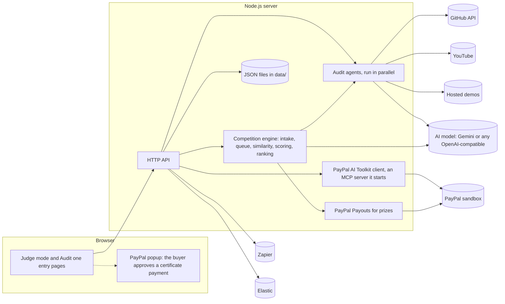

# JudgeMintAI: Product Requirements Document

Nov 5, 2026

## Overview

JudgeMintAI judges whole hackathons and competitions. It takes every entry, checks which ones are real and follow the event's rules, finds copies, scores and ranks the rest with a written reason for each rank, and leaves the final decision to the judges. When the judgement is final, each prize can be paid through PayPal from the same screen. A single team can also audit its own PayPal and AI entry before it submits, and buy a signed certificate through the PayPal sandbox.

**Problem.** Judges open dozens or hundreds of entries by hand. Some entries are fake or copied, many mention an API in the README but never call it, some leak keys, and some miss the licence, video or date rules. Judges cannot compare that many entries the same way each time, and the prizes are paid by hand afterwards. Teams learn about their problems only after they are marked down.

**Solution.** The organiser sets the event's rules and scoring criteria and brings in the entries: a pasted list, a CSV, JSON, or a GitHub organisation or topic, up to a limit that suits the server. Audit agents inspect every entry, a similarity check compares the entries with each other, and one AI call per entry scores it on the criteria. JudgeMintAI ranks the entries and explains each rank in plain words. Judges can adjust scores, reinstate or disqualify entries and reorder the list, then finalise. Each prize then has a Pay button that sends the money through PayPal's Payouts API, in the sandbox by default.

**Pitch.** An assay office for hackathon entries: every submission gets a hallmark, and the winners get paid.

| Item | Detail |
| --- | --- |
| Product | JudgeMintAI v2.0, a web app with a Node.js backend and a browser frontend. Judge mode runs a whole competition, and the single-entry audit and certificate from version 1 remain |
| Built for | Build What's Next with PayPal and AI hackathon, and any other hackathon or competition (the rules are settings) |
| Status | Working prototype, MIT licence. PayPal runs in the sandbox, and real-money payouts stay off unless the organiser switches them on |

## Users and use cases

Three groups use JudgeMintAI, and each reads a different answer out of the same audit.

| User | Need | What they get |
| --- | --- | --- |
| Participant | Know what to fix before submitting | A score, a verdict, and a fix list ordered by severity, each fix with its evidence and a plain-words remedy |
| Organiser or judge | Judge many entries quickly, consistently and with reasons, then pay the winners | One leaderboard for the event with a rank and a written reason for every entry, flags for fakes and copies, scores the judges can adjust, a decision log, a CSV export, PayPal prize payments, and optional Zapier and Elastic feeds |
| Sponsor or prize reviewer | See whether a sponsor tool is really used | A sponsor panel that lists only tools wired into the code and names claims that have no code behind them |

The main use cases:

1. **Pre-submission check.** A team audits its own repository, fixes the top issues, and audits again until the verdict is Pass.
2. **Judge a competition.** An organiser sets the rules and criteria, brings in every entry, reads the leaderboard and the reason behind each rank, lets the judges adjust it, then finalises.
3. **Fake and copy check.** Judges see which entries reuse another entry's repository or code, which only name the required technology, and which break a rule, each with its evidence.
4. **Prize payment.** After finalising, the organiser confirms each prize and pays the winner's PayPal email through the Payouts API.
5. **Proof of audit.** A team buys a certificate for a finished audit, and a judge checks its serial at the verify page.
6. **Prize check.** A reviewer opens the sponsor panel to see which sponsor tools are genuinely integrated.

Most participants are students and first-time hackathon entrants, so every finding is written in plain words and ends with what to do about it.

## Goals, non-goals and success metrics

Version 2 judges a whole competition. It catches the problems that most often cost an entry its place, finds copies and fakes, ranks every entry with an explanation, and leaves the final say, and the prize payment, to the judges. PayPal and AI work together end to end in the sandbox.

### Goals

1. Check an entry against the event's rules: a working prototype, real use of the required technology, real AI use if required, a public repository with an open-source licence, documentation, and a public demo video within the allowed length. The rules are settings, with a preset for the PayPal hackathon.
2. Make every score explainable as a check, a weight, a result and the evidence behind it.
3. Resist cheating: README claims and sponsor name-drops earn nothing, text aimed at the AI judge is flagged and earns no AI scores, and entries that copy another entry are named and held back.
4. Judge a whole competition: bring in up to a set number of entries, score each on the organiser's criteria, rank them, and write the reason for every rank in plain words.
5. Keep the judges in charge: they can adjust any score within limits, reinstate or disqualify an entry and reorder the list, and every change is logged with their name.
6. Pay the prizes through PayPal: after the judgement is final, each prize has a Pay button that cannot pay twice. A PayPal sandbox checkout, run through the PayPal AI Toolkit, issues the single-entry certificate.
7. Cost nothing to run: no npm dependencies and free tiers for every service.

### Non-goals

- Replacing human judges. The ranking supports their decision, and the judges finalise it.
- Judging an idea by reading source code with an AI model. The model scores from the pitch, a README excerpt and measured facts, and never sees the code.
- Finding copies from outside the competition. Entries are compared with each other only.
- Handling real money by default. Payments run in the PayPal sandbox unless the organiser turns live payouts on deliberately.
- Running a submission's code. Analysis is static, plus one request to the demo URL.
- Deep analysis of GitLab, Bitbucket or private repositories.
- Thousands of entries. The prototype is sized for tens.

### Success metrics (version 2 targets)

| Metric | Target | Measured by |
| --- | --- | --- |
| Fake or README-only PayPal entries wrongly passed | 0 of the 3 test fixtures | Automated tests |
| A copied entry ranked above its original | 0 in the test competition | Automated tests |
| Prizes paid twice (double click, retry, restart) | 0 | Automated payout tests |
| Prizes paid before the judgement is final or without a matching confirmation | 0 | Automated payout tests |
| Leaked secrets visible in a report | 0 | Automated test of redaction |
| Tampered certificates accepted | 0 | Automated tamper tests |
| Automated tests passing | 38 of 38 | `npm test` |
| Time to audit a typical repository | Under 60 seconds | Stopwatch on a live audit |
| Time to evaluate 10 entries with an AI key | Under 15 minutes | Stopwatch on a live run (the free Gemini tier allows about 10 calls a minute) |
| Time from final judgement to a paid prize in the sandbox | Under 2 minutes | Manual run with a sandbox personal account |
| Time from verdict to certificate in the sandbox | Under 2 minutes | Manual run with the buyer test account |

## Backend requirements

The backend is a Node.js 20+ server with no npm dependencies. It collects evidence, runs the agents, calls the AI model, ranks whole competitions and handles PayPal.

### Evidence collection

| ID | Requirement | Priority |
| --- | --- | --- |
| B1 | Accept a repository URL (required), project name, demo URL, YouTube URL, description, tools used and hackathon start date, and reject bad input with a clear message | Must |
| B2 | Read the repository through the GitHub API: metadata, languages, file tree, latest 100 commits, licence, and up to 60 prioritised source files | Must |
| B3 | Request the demo URL with a 25 second limit and manual redirects, and refuse private or local network addresses | Must |
| B4 | Read the video through YouTube oEmbed and, with an API key, confirm it is public and under 3 minutes | Should |
| B5 | Treat all repository and submission text as untrusted data | Must |

### The agents

| Agent | Weight | What it checks |
| --- | --- | --- |
| Technical Validity | 25% | Repository reachable and public, real source, README with run steps, credentials documented, manifest and entry point, commit history and progress inside the hackathon window, original work, active, tests, no committed secrets, demo reachable |
| PayPal Integration | 30% | PayPal in code and not only in docs, real API or SDK calls, complete payment flow, sandbox use, credentials from environment variables, responses not faked, PayPal and AI in one flow, server-side capture and idempotency, AI Toolkit or MCP use, demo mentions PayPal, optional AI code review |
| AI Usage | 15% | Model integrated and really called, purposeful prompts, AI central to the product, agentic design, failure handling, declared tools match the code |
| Legal and Compliance | 15% | Public repository, OSI licence visible in About and as a LICENSE file, YouTube video public and under 3 minutes, no third-party trademarks or music (flagged for a manual check), no false endorsement, no attempt to manipulate automated judging |
| Submission Completeness | 15% | Feature description, both PayPal and AI explained, tools explained, repository link, hosted demo or run instructions, video link, documentation |
| Sponsor Tools | Bonus | Which of the ten sponsor tools are wired into the code (dependency, import, script tag, hostname, config file or environment variable), and which claims have no code behind them |

### Scoring and verdict

1. Every check has a weight and a result. Pass counts 1, warning counts 0.5, fail counts 0, and not applicable is skipped. An agent's score is the weighted average, from 0 to 100.
2. The overall score is the weighted average of the five weighted agents (25, 30, 15, 15, 15). The Sponsor agent adds no points.
3. Any critical failure gives **Fail**. A score under 60 gives **Fail**. Any high-severity failure, or a score under 80, gives **Needs review**. Everything else is **Pass**.
4. The fix list is sorted by severity, then failures before warnings, then weight.
5. The AI head judge may move the score by at most 5 points and can never lift a Fail, or a submission that tries to manipulate the judge.

### PayPal checkout (AI Toolkit and Orders v2, sandbox)

| ID | Requirement | Priority |
| --- | --- | --- |
| P1 | Create the order on the server with intent CAPTURE, the amount and currency from server settings, and a `PayPal-Request-Id` header for idempotency | Must |
| P2 | Capture on the server and accept only a COMPLETED order whose amount and currency match and that belongs to this audit | Must |
| P3 | Issue no certificate for a Fail verdict or an unfinished audit | Must |
| P4 | Sign the certificate with HMAC-SHA256 so that changing its repository, score, verdict, issue time or PayPal order id fails verification | Must |
| P5 | Send the browser only the public client id, never the secret | Must |
| P6 | Use PayPal's sandbox host by default | Must |
| P7 | Create and capture the certificate order through the PayPal AI Toolkit's MCP server (create\_order and pay\_order). The server starts it in the background, and PAYPAL\_VIA=auto falls back to the direct Orders API whenever the toolkit cannot be used | Must |
| P8 | After a toolkit capture, read the order back from PayPal and accept it only when it is COMPLETED and its amount, currency and order id match the audit | Must |
| P9 | Start the toolkit with a sandbox access token and only the order permissions it needs, keep the app's secrets out of its environment, and let PAYPAL\_VIA choose auto, toolkit only or direct API only | Should |

### AI head judge

- Calls any OpenAI-compatible chat endpoint, with Gemini 2.5 Flash as the default, and asks for JSON only.
- Writes the judge notes, reviews the PayPal integration, and may adjust the score within 5 points.
- If the key is missing or the call fails, the audit finishes in rule-based mode with no error.

### Integrations

- **Zapier:** sends a JSON message to a Catch Hook URL when an audit completes and when a certificate is issued.
- **Elastic:** indexes each finished single audit, and every entry of a finalised competition (rank, scores, flags and the reason for the rank, never an email address), so organisers can search and aggregate.
- A failure in either one never blocks or breaks an audit.

### Competition engine (Judge mode)

Judge mode holds many entries in one competition, evaluates them two at a time, compares them with each other and ranks them. Every route needs the organiser key.

| ID | Requirement | Priority |
| --- | --- | --- |
| C1 | Create a competition with a name, rules (the PayPal hackathon preset or the organiser's own), scoring criteria with weights, an audit weight of 0 to 50%, an entry limit and prizes | Must |
| C2 | Bring in entries from a pasted list, a CSV, JSON, or a GitHub organisation or topic, skip bad or repeated rows with a reason, and stop at the entry limit (10 by default, 50 at most on this server) | Must |
| C3 | Evaluate entries two at a time in a queue with a four-minute limit each. An entry that fails is marked and does not stop the others, and work interrupted by a restart is marked and can be run again | Must |
| C4 | Audit each entry against the competition's rules: the required technology really used in code, AI, licence, video, dates, run steps and leaked secrets, plus the organiser's own rules, checked by the AI model or listed for a human when there is no AI key | Must |
| C5 | Compare entries with each other: same repository, forks, identical files, similar code that survives renamed variables, similar texts, and the same video or demo. Name the copy and the original by creation date | Must |
| C6 | Score each entry from 0 to 10 on every criterion with one model call per entry, from the pitch, tools, a README excerpt and measured facts, never the source code. Without a key, use estimates from the audit facts and label them | Must |
| C7 | Treat text aimed at the AI judge as manipulation: no AI scores for that entry and a visible flag | Must |
| C8 | Rank by final score = (1 − c) × merit + c × audit score, with c set per competition (20% by default, 50% at most), the same tie-breaks every time, and a written reason for every rank | Must |
| C9 | Keep an entry out of the ranking until a judge decides when its audit failed, it was disqualified, it copies another entry with high severity, or it could not be evaluated | Must |
| C10 | Let judges adjust a criterion score by up to 5 points in steps of 0.5, comment, disqualify with a reason, reinstate, and move entries in the final order by hand | Must |
| C11 | Finalise: freeze the order and give each prize to the entry that holds its place. Reopen only while no payment has started | Must |
| C12 | Log every decision with the judge's name and the time | Must |
| C13 | Export the results as a CSV in which no cell can run as a spreadsheet formula | Should |
| C14 | Send `competition.finalised` and `prize.paid` events to the Zapier hook, and index every entry in Elastic when the judges finalise | Should |

### Prize payouts (PayPal Payouts API)

The PayPal AI Toolkit has no payout tool, so prizes use PayPal's Payouts API directly. Payments are built so that money moves only on purpose, and only once.

| ID | Requirement | Priority |
| --- | --- | --- |
| R1 | Pay only after the judgement is final, only to a ranked entry with a valid PayPal email, and never above `MAX_PAYOUT_PER_PRIZE` | Must |
| R2 | Require a confirmation that repeats the amount, currency, email and entry, and refuse the payment when any of them differs from the server's record | Must |
| R3 | Mark the prize as sending and save it before calling PayPal, so that a crash cannot leave a payment looking unpaid | Must |
| R4 | Send each attempt with a fixed `sender_batch_id` and request id, so a double click, a retry or a restart cannot pay twice. Use a new id only after PayPal has clearly refused | Must |
| R5 | When PayPal says the batch already exists, look up its real state instead of paying again | Must |
| R6 | Show the true state (not paid, sending, sent, paid, unclaimed, failed or not sure) and refresh it from PayPal on request | Must |
| R7 | Use PayPal's sandbox host by default, and refuse live PayPal unless `ALLOW_LIVE_PAYOUTS=true` is set | Must |
| R8 | Refuse to reopen the judgement, delete the competition or change the winner's email once a payment has started | Must |

### API

| Method and path | Purpose |
| --- | --- |
| `POST /api/audits` | Start an audit |
| `GET /api/audits/:id` | Progress while running, full report when done |
| `GET /api/audits` | Recent audits |
| `POST /api/audits/:id/pay/create` | Create the sandbox order, through the toolkit or the Orders API |
| `POST /api/audits/:id/pay/capture` | Capture the approved order and issue the certificate |
| `GET /api/certificates/:serial` | Verify a certificate |
| `GET /api/config`, `GET /api/health` | Public configuration (including the toolkit's state) and health check |

Judge mode routes all need the `X-Organizer-Key` header:

| Method and path | Purpose |
| --- | --- |
| `POST /api/competitions`, `GET /api/competitions` | Create a competition (with rules, criteria, prizes and an import), or list them |
| `GET`, `PATCH`, `DELETE /api/competitions/:id` | Read the leaderboard, flags, prizes and decision log, change settings until finalised, or delete (refused once a payment started) |
| `POST /api/competitions/:id/projects` | Add entries from a list, CSV, JSON or GitHub |
| `PATCH`, `DELETE /api/competitions/:id/projects/:pid` | Edit an entry's name or payout email, or remove it |
| `POST /api/competitions/:id/projects/:pid/judge` | Adjust scores, comment, disqualify or reinstate |
| `POST /api/competitions/:id/evaluate`, `/cancel` | Start or cancel evaluation |
| `POST /api/competitions/:id/order` | Set the final order by hand, or go back to the computed order |
| `POST /api/competitions/:id/finalise`, `/reopen` | Freeze the judgement, or reopen it while no payment has started |
| `POST /api/competitions/:id/prizes/:prizeId/pay`, `/refresh` | Pay a prize with a matching confirmation, or ask PayPal for its state |
| `GET /api/competitions/:id/export.csv` | The results as a CSV |
| `POST /api/organizer/check` | Check an organiser key |

### Security and privacy

- Secrets found in a repository are redacted in every report.
- A per-visitor limit (20 audits an hour by default) and at most 3 audits running at once.
- Request bodies have a size limit, and the static file server blocks folder-escape paths.
- Audits and competitions are kept in local JSON files. There are no accounts, cookies or tracking. Judge mode holds entry emails, so it sits behind the organiser key.
- The PayPal AI Toolkit runs as a separate process. It receives a sandbox access token and only the order permissions it needs, never the app's secrets, and every toolkit payment is checked against PayPal before a certificate is signed.
- Every Judge mode route needs the organiser key. It is compared in constant time, wrong guesses are throttled, and the browser keeps it for the open tab only.
- Prize money moves only after finalising, a matching confirmation and a fixed payout reference. Live PayPal is refused unless the server is configured for it on purpose.
- Entry text goes to the AI model as untrusted data, the model never receives source code, and its answers are validated before they are used.
- The CSV export defuses any cell that starts with `=`, `+`, `-` or `@`.

## Frontend requirements

The frontend is plain HTML, CSS and JavaScript with no build step, and it talks only to the backend's API. Its look is an assay office: pale mint paper, deep green ink, a drawn hallmark seal, a condensed display typeface for headlines and Libre Franklin for text.

### Features

| ID | Requirement | Priority |
| --- | --- | --- |
| F1 | Intake form with the seven submission fields, inline validation, and a **Try a public example** button that fills the form | Must |
| F2 | Live progress screen that shows each of the eight stages (evidence collector, five agents, sponsor agent, head judge) and updates by polling the API | Must |
| F3 | Report with the verdict and score seal, score by agent, prioritised fix list, sponsor panel, judge notes and checks table | Must |
| F4 | Checks table built with AG Grid: sortable columns, text filter, **Problems only** and **All checks** views, and a row detail panel | Must |
| F5 | Certificate purchase with PayPal buttons, a certificate card with a "Paid through" line, **Print certificate**, and a copyable verify link | Must |
| F6 | Verify page that checks a serial and explains the result in words | Must |
| F7 | List of recent audits | Should |
| F8 | Report addresses (`/a/<id>`) that can be shared and reloaded | Should |
| F9 | Page footer that shows the state of each integration, including the PayPal AI Toolkit (ready, starting up, unavailable or off) | Should |

### Judge mode screens

Judge mode is a second set of screens in the same app, behind the organiser key. It uses the same look and the same plain-table fallbacks.

| ID | Requirement | Priority |
| --- | --- | --- |
| J1 | Sign-in that asks for the organiser key and the judge's name, refuses a wrong key with a clear message, keeps the key for the open tab only, and offers Sign out | Must |
| J2 | Competitions list with each competition's status, evaluated entries and prizes, and a **New competition** button | Must |
| J3 | New competition form: name, preset (any hackathon or the PayPal hackathon), the rules in plain fields, editable scoring criteria with live shares, audit weight, entry limit, import (paste, CSV file, JSON, GitHub), a start-now option and prizes | Must |
| J4 | Competition dashboard: status, a progress bar while evaluating, counts, **Evaluate**, **Cancel evaluation** and **Evaluate everything again**, and warnings such as "No AI key is set" | Must |
| J5 | Leaderboard built with AG Grid, or a plain table when the script does not load: rank, entry, score bar, merit, audit, flags and the reason for the rank, with a text filter. Entries that are not ranked show a dash and the reason | Must |
| J6 | Entry page: why this rank, a score per criterion with its source (AI or estimate), its reason and a field to adjust it, the rule checks, the copies with their evidence, what the audit measured, a comment box, disqualify and reinstate, and previous and next entry | Must |
| J7 | Arrow buttons to move entries in the final order, a note when the order was set by hand, and **Go back to the computed order** | Must |
| J8 | **Finalise** with a confirmation that lists the top three, then a **Pay** button on each prize. The confirmation shows the amount, the winner and the email and says whether it is sandbox or live money. The card shows PayPal's state in words, with **Check with PayPal** | Must |
| J9 | Settings editor for rules, criteria, audit weight, entry limit and prizes (locked after finalising), adding entries later, and deleting the competition | Should |
| J10 | Decision log and **Export CSV** | Should |
| J11 | Works from the keyboard, announces messages to screen readers, and has no sideways scroll at 390 px wide | Must |

### Quality requirements

| Area | Requirement |
| --- | --- |
| Accessibility | Labelled form fields, table rows that work from the keyboard, status messages announced to screen readers, and verdicts shown as words and not by colour alone |
| Responsive | No sideways scrolling at 390 px wide, and tables turn into stacked cards on phones |
| Resilience | If AG Grid, web fonts or PayPal's script fail to load, the page falls back to a plain table, system fonts or a clear message instead of breaking, and payments use the Orders API if the PayPal AI Toolkit cannot start |
| Security | Page elements are built from text and never from raw HTML, so text in a repository cannot inject script |
| Print | The certificate prints on its own, without the rest of the app |

## Architecture and data

The browser shows results and approves payments, and the Node.js server does everything else.

Arrows point from the caller to what it calls. The six agents run in parallel once the evidence is collected, and the browser only approves the payment in PayPal's popup. The server creates and captures the order through the PayPal AI Toolkit, an MCP server it starts, and uses the Orders API instead when the toolkit cannot be used.

1. **Import.** Paste a list, upload a CSV, paste JSON, or point at a GitHub organisation or topic, up to the entry limit.
2. **Audit.** The audit agents check every entry against the event's rules.
3. **Compare.** Entries are compared with each other to find copies and duplicates.
4. **Score.** Each entry gets 0 to 10 on every criterion.
5. **Rank.** The entries are ranked, each with a written reason.
6. **Judge.** The judges adjust scores, reinstate or disqualify, reorder and comment. Every change is logged.
7. **Finalise and pay.** Finalising freezes the order, and each prize then has a Pay button that sends the money through PayPal's Payouts API (sandbox by default).

Judge mode moves each competition through seven steps, and the judges finalise before any money moves. The PayPal AI Toolkit stays on the certificate path, and prizes use the Payouts API directly.

### Data kept for each audit

| Field | Holds |
| --- | --- |
| `id`, `createdAt`, `status` | A 12-character hex id, the creation time, and whether the audit is queued, running, done or failed |
| `input` | The submission fields the user typed |
| `progress` | The eight stages, each with its state and score |
| `evidence` | What the collector fetched from GitHub, the demo URL and the video |
| `report` | Overall score, verdict, the agents with their checks, prioritised fixes and judge notes |
| `payment` | The PayPal order, its capture result, and which route (toolkit or Orders API) handled each step |
| `certificate` | Serial (`JM-` plus 12 hex characters), repository, score, verdict, issue time, PayPal order id and HMAC-SHA256 signature |
| `integrations` | Which of the Zapier and Elastic hooks ran |

### Data kept for each competition

| Field | Holds |
| --- | --- |
| `id`, `name`, `createdAt` | A 12-character hex id, the organiser's name for the event, and the creation time |
| `rules` | The event's rules: preset, theme, required technology (any or all), sandbox, AI, licence, video, run steps, dates, sponsors, the organiser's own rules and the audit weight |
| `criteria` | The scoring criteria with their weights and descriptions |
| `maxProjects` | The entry limit |
| `prizes` | Label, amount, currency and place, the winning entry once final, and the payment state with its PayPal batch id |
| `projects` | One record per entry: name, repository, demo, video, description, tools, payout email, status (pending, queued, running, done, error, interrupted or cancelled), the audit id, measured facts, the AI or estimated scores, copies found, and the judges' adjustments and comments |
| `order` | The final order, set by hand or frozen at finalising |
| `decisions` | The decision log: time, who and what |
| `finalisedAt`, `finalisedBy` | When and by whom the judgement became final |

## AI tools and technologies used

JudgeMintAI uses PayPal's AI Toolkit, Orders API and Payouts API for payments, one AI model for scoring and judging, five of the ten sponsor tools, and an AI coding assistant for development.

### PayPal tools

| Tool | How it is used | Where |
| --- | --- | --- |
| PayPal AI Toolkit (MCP server `@paypal/mcp`) | In the running app, the server starts it and calls create\_order and pay\_order for every certificate payment. While developing, it gives an AI assistant inside VS Code direct access to the PayPal sandbox: create and inspect test orders (`create_order`, `get_order`, `pay_order`), list invoices and transactions, and compare the result with what the app's checkout produces | `src/paypalToolkit.js`, `src/mcp.js`, `.vscode/mcp.json`, `scripts/get-sandbox-token.mjs` |
| PayPal Orders v2 API (sandbox) | The direct route for creating and capturing the order when the toolkit is not used, and the read-back that checks each payment before the certificate is signed | `src/paypal.js`, `server.js` |
| PayPal Payouts API (sandbox) | Pays the prizes in Judge mode: one payout per prize with a fixed `sender_batch_id` so nothing is paid twice, and a status check against PayPal. The AI Toolkit has no payout tool, so this is a direct REST call | `src/payouts.js`, `src/paypal.js` |
| PayPal JavaScript SDK (Buttons) | The buyer approves the payment in PayPal's popup | `public/js/pay.js` |

### AI models

| Tool | How it is used | Where |
| --- | --- | --- |
| Gemini 2.5 Flash, or any OpenAI-compatible model | In Judge mode, one call per entry scores it from 0 to 10 on each criterion with a reason and checks the organiser's own rules. In the single-entry audit, the head judge writes the verdict notes, reviews the PayPal integration code, and may move the score by at most 5 points. The default is Google's OpenAI-compatible endpoint with a free AI Studio key, throttled to its 10 calls a minute | `src/llm.js`, `src/scoring.js`, `src/agents/judge.js`, `src/agents/paypalAgent.js` |
| Estimates without a model | With no AI key, Judge mode scores from the audit's measured facts and the wording, labels every score an estimate with a confidence, and tells the judges to review them | `src/scoring.js` |
| Multi-agent design | In the single-entry audit, five specialist agents plus a sponsor agent and a head judge run in parallel and hand their findings to the judge. In Judge mode the same agents run for every entry, with a required-technology agent that reads the event's rules, and a similarity check and the ranking sit on top | `src/auditor.js`, `src/agents/`, `src/similarity.js`, `src/ranking.js` |

The model's role is deliberately bounded. Rules produce the checks, so a score can be reproduced and explained line by line, while the model supplies judgement and wording on top. In Judge mode the model never sees source code, its answers are validated before they count, and judges can adjust any score.

### Sponsor tools used

| Tool | How it is used | Where |
| --- | --- | --- |
| AG Grid | Sortable, filterable table of every check in the report, and the Judge mode leaderboard | `public/js/grid.js`, `public/js/board.js`, `public/index.html` |
| Render | Hosts the app as a free Node web service | `render.yaml` |
| Zapier | Receives `audit.completed`, `certificate.issued`, `competition.finalised` and `prize.paid` webhooks so organisers can route results to their own tools | `src/integrations.js` |
| Elastic | Indexes every finished single audit, and every entry of a finalised competition (rank, scores, flags and the reason, never an email address), so organisers can search and aggregate across entries | `src/integrations.js` |
| Postman | A collection with tests that runs the whole API, including the PayPal sandbox flow and a Judge mode run from import to prize payment | `postman/JudgeMintAI.postman_collection.json` |

Not used in version 2: APIMatic, Astropods, Bryntum, Channel3 and KERNEL. The roadmap says where two of them could fit.

### Development tools

| Tool | How it is used |
| --- | --- |
| Claude (Anthropic) | AI coding assistant that wrote the code in this repository, with every file checked by running the tests |
| VS Code | Editor, and the place where the PayPal AI Toolkit connects |
| Node.js 20 or newer | Runtime. The built-in `http`, `fetch`, `crypto` and `node:test` mean the project has no npm dependencies |
| Playwright (headless Chromium) | Browser checks of every screen, including phone width, during development |
| GitHub | Public repository with the MIT licence |

## Quality: tests, acceptance criteria and known limits

Version 2 is accepted when all 38 automated tests pass, a manual sandbox payment issues a certificate that the verify page accepts, a sandbox prize payment reaches a test account, and the main screens work from phone width to desktop.

### Test plan

| Layer | What it covers | How |
| --- | --- | --- |
| Automated backend tests | Input validation, self-audit, sponsor name-drops against real wiring, a fake PayPal repository, prompt injection, missing repository, video rules, private-address blocking, the full PayPal flow, the same flow through a stand-in PayPal AI Toolkit (including a toolkit that cannot start, hangs, crashes or reports success for an unpaid order), payment safeguards, config exposure, folder-escape paths | `npm test`, with local stand-ins for GitHub, PayPal, YouTube and the PayPal AI Toolkit |
| Judge mode tests | Rules and presets, the required-technology agent, intake limits and bad rows, copy detection (renamed variables, direction by creation date), ranking maths, tie-breaks and manual order, judge adjustments, finalise and reopen, the organiser key on every route, one AI call per entry, instructions hidden in a README, work interrupted by a restart, and prize payments (only after finalising, a matching confirmation, never twice, refusals, timeouts and a crash mid-payment) | `npm test`, with local stand-ins for GitHub, PayPal Payouts and the AI model |
| Self-audit | JudgeMintAI audits its own source tree and must pass | Part of the automated tests |
| Browser checks | Form, validation, progress, report, certificate, verify page, the whole Judge mode path (sign-in, create, evaluate, leaderboard, entry page, adjust, reinstate, reorder, finalise, pay, export, sign out), and no sideways scroll at phone width | Headless Chromium during development, against the same stand-ins |
| Manual sandbox run | The real PayPal sandbox: the buyer pays, a certificate issues and the verify page says valid; a test prize is paid to a sandbox personal account | The Testing section of the build guide |
| API checks | Every route, with assertions | The Postman collection |

### Acceptance criteria

1. Submitting an empty form shows "Add your repository URL. It is the only required field."
2. An entry with README-only PayPal claims, a mocked payment, a leaked key and no licence ends in Fail, and the key never appears in the report.
3. An audit that is Pass or Needs review can buy a certificate for the configured price in the sandbox, and a Fail audit cannot.
4. The issued serial shows Valid on the verify page, and changing the score, verdict or repository in the record makes it invalid.
5. With no AI key and no Zapier or Elastic settings, every audit still completes.
6. The report has no sideways scroll at 390 px wide.
7. With the toolkit unable to start, a payment still completes through the Orders API, and a toolkit that reports success for an order PayPal says is unpaid gets no certificate.
8. A competition of four entries imports, evaluates and ranks. An entry that copies another is flagged with the original's name and is not ranked until a judge reinstates it.
9. Every Judge mode request without the organiser key is refused.
10. A prize cannot be paid before the judgement is final, with a confirmation that differs from the record, or a second time. After a payment starts, the judgement cannot be reopened.
11. A sandbox prize payment shows PayPal's state in words, and Check with PayPal updates it.
12. The Judge mode screens have no sideways scroll at 390 px wide.

### Known limits

- Only GitHub repositories get deep analysis. GitLab and Bitbucket links get the paperwork checks only.
- Video length and visibility need a YouTube API key, and music copyright cannot be checked by a machine.
- Only the first 60 source files are read, starting with manifests, PayPal code and server code.
- Audits and competitions live in JSON files. On Render's free plan those files are wiped on every deploy or restart, so export the CSV when judging ends.
- The tests use stand-ins for GitHub, PayPal (orders and payouts), YouTube, the AI model and the PayPal AI Toolkit. The first run against the real PayPal sandbox (including a test payout), the real @paypal/mcp package, the AG Grid script host and Google Fonts happens on the team's own computer.
- The agents' checks are rules and can misjudge an unusual project, so a verdict supports human judges and does not replace them.
- Orders made through the PayPal AI Toolkit cannot carry the audit id in PayPal's own record, so the server matches them by the order id it stored. The toolkit takes USD only.
- Copy detection finds copies with small edits, not a heavy rewrite, and compares only the entries of one competition. A flag is a reason to look, and judges can reinstate an entry.
- The AI scores an entry from its pitch, a README excerpt and measured facts, never from reading the code, so it can overrate a good pitch. Without an AI key the scores are labelled estimates.
- The prototype is sized for tens of entries. GitHub allows about 10 entries an hour without a token, and the free Gemini tier allows about 10 calls a minute.
- PayPal can hold or return a payout (an email with no PayPal account shows as unclaimed). Fees, tax forms and identity checks for real prizes are the organiser's job.

## Roadmap and risks

Before the deadline the work is to prove the checkout and the prize payout against the real PayPal sandbox and finish the submission. After that the roadmap deepens the judging and the integrations.

### Roadmap

| Phase | Item | Why |
| --- | --- | --- |
| Before the deadline | Run the first live sandbox payment through the PayPal AI Toolkit, with PAYPAL\_VIA=rest as the fallback, and fix anything PayPal-specific | It is the one path that has only been tested against stand-ins |
| Before the deadline | Pay a test prize: finalise a small competition, pay a sandbox personal account, and press Check with PayPal | The Payouts path has only been tested against a stand-in |
| Before the deadline | Run a competition of about 10 real entries with a GitHub token and an AI key, and read the ranking with the judges | Checks that the scores and copy flags feel fair on real projects |
| Before the deadline | Publish the repository with the MIT licence, deploy to Render, record the demo video | Hackathon submission requirements |
| Next | Compare entries with code from outside the competition, and add an AI consistency check that compares the description, the video script and the code | Catches copies from elsewhere and gives the model more to judge |
| Later | KERNEL: open the live demo in a cloud browser and capture evidence | Proves the demo really works |
| Later | APIMatic: publish an OpenAPI description and generate a client SDK and docs | Easier use of the API |
| Later | Deep analysis of GitLab and Bitbucket, and a database in place of the JSON files | Wider coverage and durable data on free hosting |

### Risks

| Risk | Impact | Mitigation |
| --- | --- | --- |
| The real PayPal sandbox behaves differently from the test stand-in | Checkout or a prize payment fails in the demo | Run the manual sandbox test early and use the troubleshooting list in the build guide |
| The sandbox app cannot send payouts, or the test business account has no funds | The Pay button shows PayPal's refusal, for example NOT\_AUTHORIZED | Check the app's features and the sandbox account's balance, and read the message the app shows in PayPal's own words |
| GitHub allows only 60 reads an hour without a token | Audits and imports stop after about 10 entries, with a rate-limit message | Add the free `GITHUB_TOKEN`, which raises the limit to 5,000 an hour |
| The free AI quota runs out | No written judge notes, and estimated scores in Judge mode | The audit continues in rule-based mode, scores are labelled estimates, and a model failure never breaks it |
| Render's free plan sleeps and wipes data on restart | A slow first request, and old certificates and competitions are lost | Warm the app up before the demo, record the video in one session, and export the CSV when judging ends |
| A submission tries to manipulate the AI judge | An unfair score | Repository text is untrusted data, manipulation attempts are flagged and earn no AI scores, and the model cannot lift a Fail or move the audit score more than 5 points |
| The rules or the AI misjudge an unusual project | An unfair verdict or rank | Every check and score shows its evidence and reason, judges can adjust any score, and human judges make the final call |
| A copy is missed, or an honest entry is flagged as a copy | An unfair rank | Flags show their evidence, judges can reinstate or disqualify, and the final order is theirs |
| Someone obtains the organiser key | They could read entry emails or pay prizes | Choose your own `ORGANIZER_KEY`, keep it private, and rely on the confirmation step, the per-prize cap and the sandbox default |
| The real PayPal AI Toolkit package behaves differently from the test stand-in, or cannot be downloaded | Payments fall back to the Orders API, and the toolkit cannot be shown in the demo | Look for "PayPal AI Toolkit ready" early, set PAYPAL\_VIA=rest if the toolkit or the PayPal popup misbehaves, and claim the toolkit only if the certificate says it was used |

## Sources

- [PayPal AI Toolkit: MCP server setup](https://developer.paypal.com/tools/mcp-server/)
- [PayPal AI Toolkit: agent tools catalog](https://developer.paypal.com/ai-tools/agent-tools/)
- [PayPal Payouts v1 API reference](https://developer.paypal.com/api/payments.payouts-batch/v1)
- [PayPal Standard Payouts: integrate the API](https://developer.paypal.com/docs/payouts/standard/integrate-api/)
